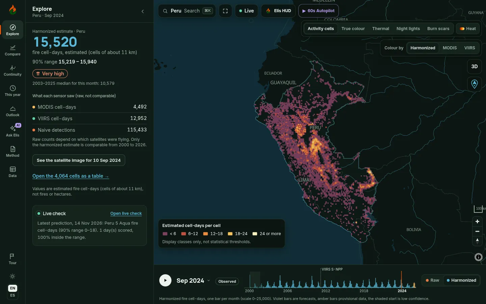
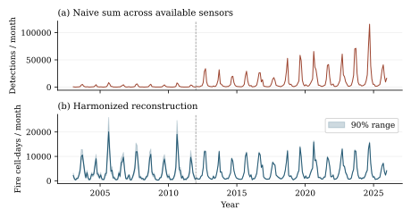
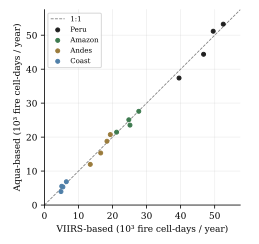
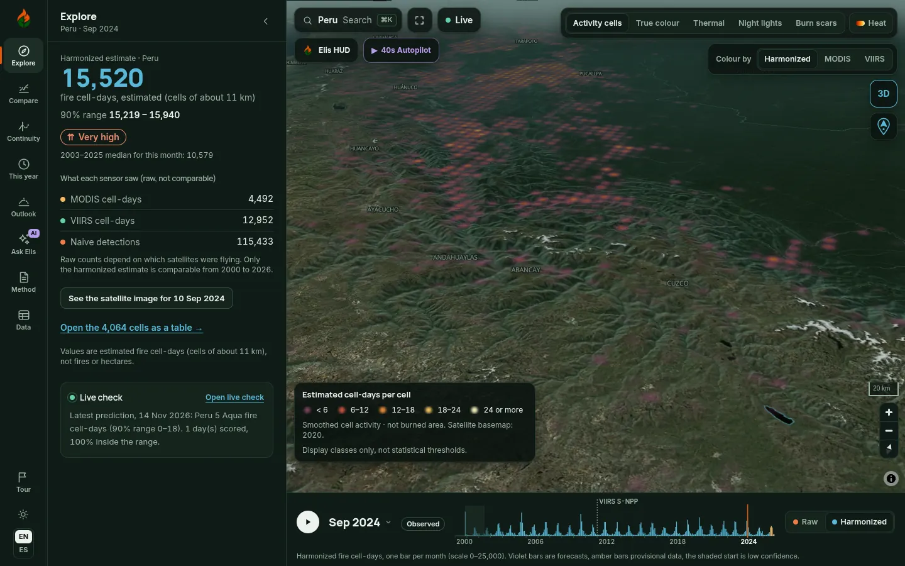
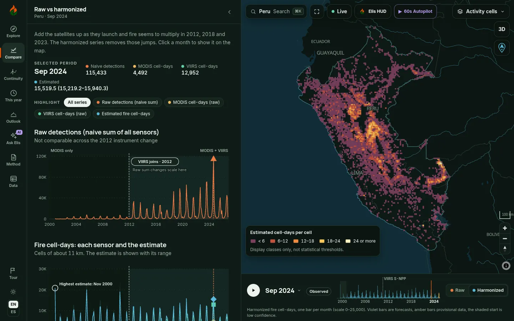
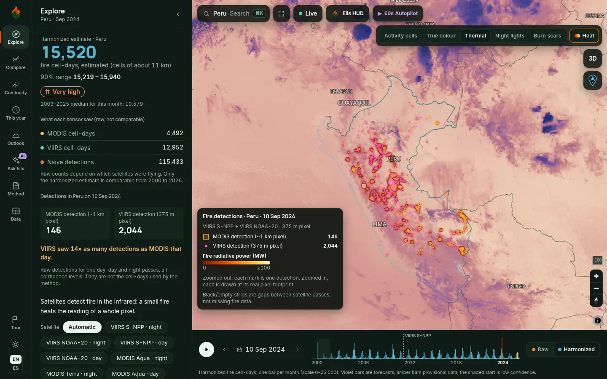
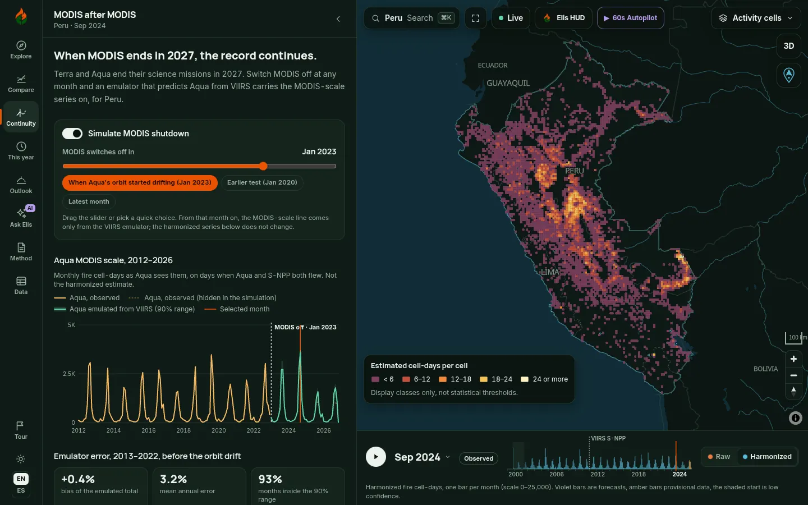
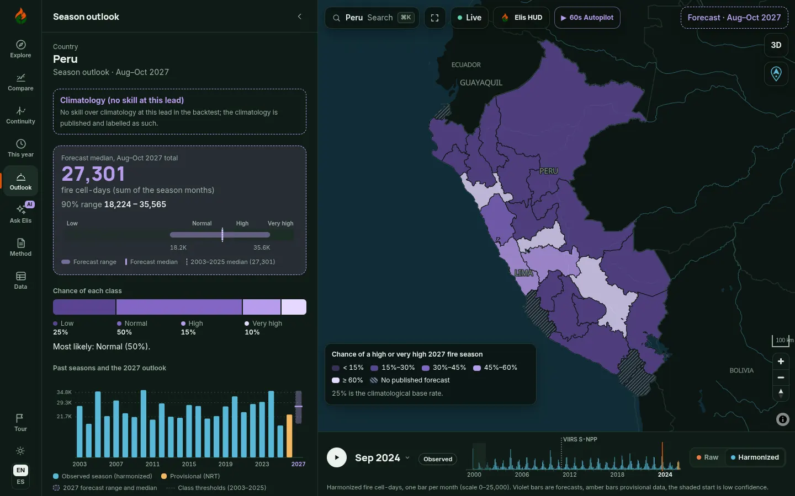
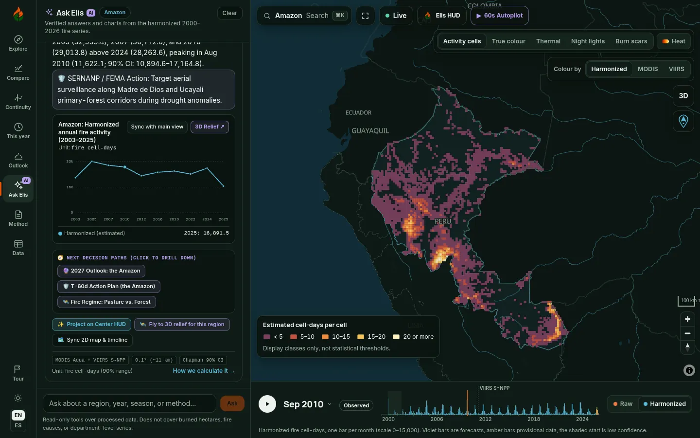

<div align="center">


# Elis

### One comparable fire record for Peru, 2000–2026

**Two NASA satellite eras, MODIS and VIIRS, turned into a single record you can compare year to year, always with its 90 % range.**

Team **Log N + 1** · NASA Space Apps Challenge 2026 · *Harmonization of MODIS and VIIRS Hot Spots*

[](https://www.youtube.com/watch?v=Fkg9rDq_U2Y)
[](https://elis-peru.vercel.app)
[](https://elis-peru.vercel.app/landing/)
[-0B3D91?style=for-the-badge)](https://elis-peru.vercel.app/firechronos-technical-report.pdf)


<br>



</div>

---

## At a glance

<div align="center">

| | |
|:---:|:---:|
| **334 % → 3.8 %** | **24,392 vs 22,955** |
| yearly error, naive sum vs Elis<br><sub>held-out years 2021–2024, Peru</sub> | forecast vs observed fire cell-days<br><sub>2026 season, never seen by the model</sub> |
| **×8.9 → ×1.39** | **15 of 20** |
| 2011→2012 jump, raw vs harmonized<br><sub>the sensor changed, not the fire</sub> | departments where the outlook<br><sub>beats climatology</sub> |
| **r = 0.75** | **26 years** |
| correlation with MapBiomas burned area<br><sub>independent Landsat product</sub> | of comparable monthly record<br><sub>2000–2026, with 90 % ranges</sub> |

</div>

## The problem

Peru burns every dry season, and satellites are how we know how much. But the satellites changed over time, and the record changed with them.

MODIS (1 km pixels, since 2000) and VIIRS (375 m pixels, since 2012) detect fire differently. Raw counts jump in 2012, 2018 and 2023 as satellites join the record (VIIRS S-NPP, NOAA-20, NOAA-21). In Peru the naive sum goes from **10,375 detections in 2011 to 92,807 in 2012**: a false ×8.9 jump.

> **The fire did not change. The instrument did.** Anyone who compares fire years across 2012, or fits a trend on the raw sum, is measuring the satellites, not the fires.

<div align="center">

</div>

## How Elis works

Elis turns the satellites' disagreement into a measurement. **The unit** is the **fire cell-day**: a 0.1° cell (about 11 km) on a date with at least one detection. It is not a count of fires and not hectares burned.

| | Step | What it does |
|:---:|---|---|
| **1** | **Pair the passes** | Keep only days when Aqua MODIS and S-NPP VIIRS pass less than 20 minutes apart, so both look at the same fire. |
| **2** | **Measure the overlap** | On those passes, 80 % of Aqua fire cell-days are also seen by VIIRS. The overlap tells how much each sensor misses. |
| **3** | **Estimate the unseen** | Capture–recapture (the Chapman estimator, borrowed from wildlife counts) estimates the fire both sensors missed, with a 90 % bootstrap range. |

**Also in Elis**

| Component | What it adds |
|---|---|
| **Bayesian three-list check** | Aqua, S-NPP and NOAA-20 show the sensors are positively dependent: the record is a **lower bound, roughly 10–15 % low**. No correction passed our tests, so none is applied. |
| **Synthetic MODIS** | A gradient-boosting emulator (AUC 0.76) predicts what Aqua would see from VIIRS. It measures the drifting Aqua orbit (29 % fewer fire cell-days in 2026) and keeps the MODIS-scale record going after MODIS retires in 2027. |
| **Seasonal outlook** | A forecast built on the record with ENSO and drought predictors, always labelled and kept apart from observations. |
| **Live sealed predictions** | Every day a prediction is committed to [elis-live](https://github.com/piales00/elis-live) before the satellite data it is scored against exist. |

### Observations, estimates and forecasts

Elis never mixes these three. The app, the API and the paper label each one.

| Kind | What it is | Range |
|---|---|---|
| **Observation** | Detections reported by FIRMS, as received (near-real-time data are provisional) | None |
| **Estimate** | The harmonized record | 90 % range |
| **Forecast** | The seasonal outlook, including 2027 departmental outlooks | Backtested, always labelled |

## Validation

| Check | Result |
|---|---|
| **Held-out years 2021–2024** (Aqua-only vs VIIRS-only rebuilds) | **3.8 %** yearly difference for Peru (Amazon 2.3 %, Andes 7.0 %, Coast 9.0 %), against 334 % for the naive sum |
| **Independent burned area** (MapBiomas Fuego, Landsat) | r = 0.75 for Peru, 0.85–0.98 within each Landsat era |
| **2026 season out of sample** | Forecast 24,392 [18,848–31,568] vs observed 22,955 fire cell-days |
| **Trend** | +16.8 % per year on raw detections → +0.2 % per year on the harmonized record |

<div align="center">

</div>

## The app

<table>
<tr>
<td width="50%"><br><b>3D view</b> · fire activity over real Sentinel-2 relief</td>
<td width="50%"><br><b>Compare</b> · raw detections vs the harmonized record</td>
</tr>
<tr>
<td><br><b>Satellite layers</b> · true colour, thermal, night lights, burn scars</td>
<td><br><b>Continuity</b> · switch MODIS off and the record goes on</td>
</tr>
<tr>
<td><br><b>Outlook</b> · seasonal forecast by department</td>
<td><br><b>Ask Elis</b> · plain-language answers, every number checked against the data</td>
</tr>
</table>

**Ask Elis** uses Google Gemini (`gemini-3.1-flash-lite`) with read-only tools over the processed files; every figure it returns is verified against the data. A 40-second autopilot walks through the four key findings.

## Resources

| | |
|---|---|
| ▶ **Demo video (30 s)** | [youtube.com/watch?v=Fkg9rDq_U2Y](https://www.youtube.com/watch?v=Fkg9rDq_U2Y) |
| 🌐 **Project page** | [elis-peru.vercel.app/landing](https://elis-peru.vercel.app/landing/) |
| 🗺️ **Live app** | [elis-peru.vercel.app](https://elis-peru.vercel.app) |
| 📄 **Technical paper** | [PDF](https://elis-peru.vercel.app/firechronos-technical-report.pdf) · [HTML source](docs/report/firechronos-technical-report.html) |
| 📊 **Pitch deck** | [PDF](https://elis-peru.vercel.app/elis-presentation.pdf) |
| 📚 **Methods notes** | [`docs/methods/`](docs/methods/README.md) |
| 🔌 **Public API** | [elis-api.onrender.com](https://elis-api.onrender.com/docs) · e.g. `GET /series?region=peru` |
| 📡 **Daily sealed predictions** | [github.com/piales00/elis-live](https://github.com/piales00/elis-live) |
| 🧾 **Data contract** | [`docs/contrato-datos.md`](docs/contrato-datos.md) (paths, fields, parameters) |

## Data sources

- NASA FIRMS: MODIS Terra and Aqua, VIIRS S-NPP, NOAA-20, NOAA-21
- [NASA GIBS / Worldview](https://www.earthdata.nasa.gov/engage/open-data-services-software/earthdata-developer-portal/gibs-api): VIIRS S-NPP / NOAA-20 and MODIS Terra / Aqua Corrected Reflectance (true colour and SWIR); VIIRS I5 and MODIS band 31 brightness temperature; VIIRS S-NPP / NOAA-20 Day/Night Band. Daily detections use VIIRS S-NPP 375 m and MODIS Terra / Aqua Thermal Anomalies vector tiles. Credit: NASA GIBS / Worldview and NASA FIRMS.
- NASA POWER (precipitation and temperature)
- NOAA CPC ONI and ENFEN ICEN (ENSO indices)
- MapBiomas Fuego Peru (burned area, used for validation)
- INEI (department boundaries)

### Map resources, live feed and assistant credits

- [EOX Sentinel-2 cloudless 2020](https://s2maps.eu): satellite basemap for the 3D view, licensed under **CC BY-NC-SA 4.0**. Required attribution: "Sentinel-2 cloudless – https://s2maps.eu by EOX IT Services GmbH (Contains modified Copernicus Sentinel data 2020)". The mosaic represents 2020, not the selected fire date.
- [AWS Terrain Tiles / Mapzen](https://registry.opendata.aws/terrain-tiles/): Terrarium elevation tiles from the public `elevation-tiles-prod` bucket for 3D relief and hillshade. Credit: Mapzen / AWS Terrain Tiles and the underlying elevation providers; source-specific licences and attribution are linked from the AWS registry.
- [OpenFreeMap](https://openfreemap.org/): vector basemap, using the OpenMapTiles schema and [OpenStreetMap](https://www.openstreetmap.org/copyright) data. © OpenStreetMap contributors, Open Database Licence (ODbL).
- [Elis public live feed](https://github.com/piales00/elis-live): daily sealed predictions and observed results for the live check. Credit: Log N + 1 / Elis; underlying satellite data retain their providers' terms and attribution.
- [Google Gemini](https://ai.google.dev/gemini-api/docs/models), model `gemini-3.1-flash-lite`: the language model behind **Ask Elis**, using tools to query Elis datasets with automatic verification of returned figures. Google service terms apply; its output is not an independent scientific data source.
- Inter and Manrope, delivered through Google Fonts for interface typography.

The raw FIRMS CSV files are not in the repository. Annual MODIS and VIIRS S-NPP files go in `data/raw/`; the 2026 NOAA-20/21, MODIS and S-NPP files go in `data/raw/2026/`. Small aggregates in `data/processed/` are committed. Never commit FIRMS source files, credentials, `.env` or `.venv`.

## Run it

### 1. Requirements

- Python 3 and Node.js
- FIRMS access credentials (only to download source data)

```bash
python3 -m venv .venv
.venv/bin/pip install -r requirements.txt
```

On Windows PowerShell:

```powershell
py -m venv .venv
.\.venv\Scripts\python.exe -m pip install -r requirements.txt
```

The commands below use the Linux/macOS path; on Windows use `.\.venv\Scripts\python.exe`.

### 2. Download the data

```bash
.venv/bin/python scripts/download_peru_sources.py
```

### 3. Process the data

Run in this order. Parameters live in `scripts/config.py`.

```bash
.venv/bin/python scripts/cells.py
.venv/bin/python scripts/cells.py --all-types
.venv/bin/python scripts/capture_recapture.py
.venv/bin/python scripts/modis_emulator.py
.venv/bin/python scripts/build_series.py
.venv/bin/python scripts/validate.py
.venv/bin/python scripts/build_map.py
.venv/bin/python scripts/fetch_power.py
.venv/bin/python scripts/forecast.py
.venv/bin/python scripts/forecast_v2.py
.venv/bin/python scripts/continuity.py
.venv/bin/python scripts/export_static.py
```

`export_static.py` runs last. It copies a snapshot of the published files to `web/public/data/` (about 11 MB, one compact map file per month), so regenerate it whenever `data/processed/` changes.

### 4. Run the API

The API serves the precomputed files in `data/processed/`; it does not run the pipeline per request.

```bash
.venv/bin/python -m uvicorn api.main:app --reload
```

Interactive docs: http://127.0.0.1:8000/docs. Endpoints: `GET /regions`, `GET /series`, `GET /map`, `GET /methodology`.

### 5. Run the web app

```bash
cd web
npm install
npm run dev
```

| Variable | Default | Meaning |
|---|---|---|
| `VITE_DATA_SOURCE` | `mock` | `mock` uses the sample data in `web/mock/`; `api` uses the API |
| `VITE_API_BASE` | `http://localhost:8000` | API address |
| `VITE_LIVE_FEED_URL` | public elis-live repo | Overrides the base URL of the daily sealed predictions |

```bash
VITE_DATA_SOURCE=api VITE_API_BASE=http://localhost:8000 npm run dev
```

With `VITE_DATA_SOURCE=api`, if the API is down or asleep the app keeps working from the static snapshot in `web/public/data/`, shows an "Archived data snapshot" badge, and retries the API every few seconds. The live check reads the daily sealed predictions from the public [elis-live](https://github.com/piales00/elis-live) repository first (`VITE_LIVE_FEED_URL` overrides its base URL), then the API, then the snapshot.

The optional "Ask Elis" assistant is off unless `CHAT_ENABLED=1` is set for the API. Configure `CHAT_PROVIDER=gemini` and `GEMINI_API_KEY` to use Google Gemini (`gemini-3.1-flash-lite` by default). `CHAT_MODEL` overrides the model. The API also supports `CHAT_PROVIDER=anthropic` with `ANTHROPIC_API_KEY`.

## Repository structure

```
data/raw/          FIRMS CSV files (not committed)
data/processed/    Small aggregates that are committed (series.json, methodology.json, ...)
scripts/           ETL and method in Python with DuckDB
api/               FastAPI app that serves the precomputed files
web/               React + Vite + Tailwind front end (web/mock/ has sample data)
docs/methods/      Technical notes
docs/report/       Technical report (HTML and PDF)
```

## Known limitations

We state them on purpose: a record that hides its limits is not more solid, only less honest.

- **The record is a lower bound.** The sensors are positively dependent, so fire missed by both (cloud, smoke, small or short fires) stays missed. We estimate it is roughly 10–15 % low. No correction passed our tests, so none is applied.
- **The unit is not fires or hectares.** Fire cell-days measure where and when fire was detected, in 0.1° cells.
- **Estimates carry a 90 % range.** Read the range, not only the central value.
- **NRT data are provisional** until FIRMS replaces them with standard data.
- **The Aqua orbit is drifting**, so it sees 29 % fewer fire cell-days than an on-time Aqua in 2026. Elis corrects for this, but the correction has its own uncertainty.
- **Forecasts are not observations.** They beat climatology in backtests, which does not guarantee any single season.
- **Regional accuracy varies.** The held-out gap is 2.3 % in the Amazon, 7.0 % in the Andes and 9.0 % on the Coast.

## Team

**Log N + 1** · Peru · NASA Space Apps Challenge 2026

| | Member | Role | What they built |
|:---:|---|---|---|
|  | **Piero Pérez** | AI & Backend Engineer · Statistical methods | Model training, capture–recapture harmonization, validation and backend integrations |
|  | **Jossep Hurtado** | Data Engineer · Public API | FIRMS download and processing, FastAPI endpoints, published files in `data/processed/` |
|  | **Samuel Ortega** | Frontend Engineer · Design | Interface, maps, charts, user experience and the demo video |
|  | **Valentino Llamocca** | AI Engineer · Conversational assistant | Ask Elis: the data assistant and its mission HUD |

## AI use

The team used AI coding and writing assistants (Anthropic Claude, OpenAI Codex) to help write code, documentation and translations under the team's direction. Ask Elis uses Google Gemini inside the app, with every figure checked against the data. The two opening shots of the demo video are AI-generated cinematic reconstructions, labelled on screen. No AI model produces the published figures: the method runs on our own code and NASA data, and all methods, data choices and results were defined, checked and validated by the team.

<div align="center">

**NASA Space Apps Challenge 2026 · Harmonization of MODIS and VIIRS Hot Spots**

</div>
